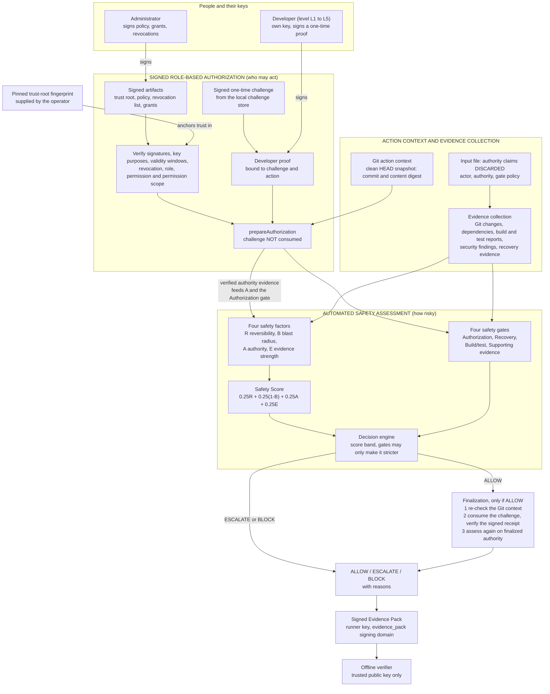
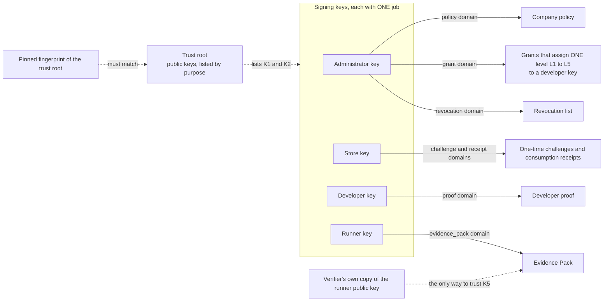

# CodeXRev Feature 4 — Architecture

This document describes the architecture **as implemented**. The diagrams are drawn from the code; they are not a
design for future work. Diagrams use [Mermaid](https://mermaid.js.org/) (GitHub, VS Code and many Markdown viewers render
them).

The pipeline is: **Signed Role-Based Authorization → Automated Safety Assessment → ALLOW / ESCALATE / BLOCK → Signed
Evidence Pack.** Authority comes from administrator-signed *grants* that are reused for every authorized action until
they expire or are revoked. A separate per-action team-lead approval is **not** part of the current design (an earlier
version had one; it was removed, together with its command, its signed files, its policy fields and its gate).

## 1. The key idea: two separate questions

Feature 4 answers two different questions and keeps them apart:

| Question | Answered by | Based on | Can be faked by editing a JSON file? |
|---|---|---|---|
| **Who is allowed to do this action?** | **Authorization verification** | an administrator-signed grant (role, optional narrower scope, expiry), the signed policy, a proof of possession, revocation — all checked against a pinned trust root | **No** |
| **How risky is this action?** | **Safety scoring** — four factors, a Safety Score and four gates | observed Git state, build/test and security reports, recovery evidence | partly (stated estimates are capped and labelled; see limitations) |

Verified authorization is *an input* to the safety assessment (it supplies the **Authority** factor and the
**Authorization** gate). It does not replace the score or the other three gates, and it never guarantees ALLOW: **a role
is never a bypass.** A developer at L4 or L5 who is allowed to deploy to production must still reach a Safety Score of at least
0.80, pass the Recovery, Build/Test and Supporting-Evidence gates, keep the Git commit unchanged and finish the one-time
challenge.

## 1a. Authorization levels L1 to L5

Authority is expressed as one of five standardized, company-independent **levels**. The central registry
(`authorization/levels.ts`) defines ten machine-readable permissions, each tied to exactly one real (action type, environment)
pair, and the fixed permission set of each level (cumulative: L1 `code.modify`; L2 + `dependency.update`, `config.development`;
L3 + `deployment.staging`, `config.staging`, `migration.staging`; L4 + `deployment.production`, `rollback.production`;
L5 + `infrastructure.maintenance`, `database.maintenance`). The matrix is in `FEATURE4_DEMO_GUIDE.md` Section 2a.

* **Where it is enforced.** The signed policy (format **version 3**) must be *exactly* the registry: the five levels with their
  permissions and the ten rules. The verifier refuses a version 3 policy that differs (for example one giving `l1` the production
  permission), so a level cannot be redefined by editing a file, or even by an administrator-signed file. Policy version 2 stays supported
  as a generic custom-role format in the library, but the strict tooling refuses it; version 1 and unknown versions are unsupported.
* **How a developer is bound to a level.** A grant names exactly one level as its role (`l1` to `l5`) inside the administrator-signed
  payload, together with the developer's public key, an optional narrower `permissionScope`, the grant id, the validity period and
  the issuer. The grant verifier rejects a level-policy grant that is not exactly one level. A developer who edits `l2` to `l5`
  breaks the administrator's signature; a grant signed by a developer key or by any key the trust root does not list for grants is refused.
* **What a level is not.** It only lets a person *request* an assessment. Expiry, revocation, proof of possession, the Git binding,
  the Safety Score and the four gates are checked independently, and a level never guarantees ALLOW.
* **Known gaps (fail closed).** The Git/action binding supports only `code_change` and `deployment`, so migrations, rollbacks and
  configuration changes are authorized by level but the assessment stops at the binding until a non-Git artifact binding exists;
  and the taxonomy cannot tell infrastructure from application configuration, so `infrastructure.maintenance` is the narrowest
  existing mapping (configuration change in production, L5 only).

## 1b. Employee onboarding through `codexrev init`

`codexrev init` onboards an employee by asking only for the employee id, name and level. `src/cli/initAuthorization.ts` is only the prompts; it calls
`provisionDeveloperAuthorization` (`strict/projectAuthorization.ts`), which reuses the level registry, the version 3 policy, `issueGrant`, the trust-root pin and
the key store. The certificate is the existing signed grant (which now optionally carries the employee name inside its signed subject), saved under
`.codexrev/authority/grants/` (read-only where supported) with a small pointer record `.codexrev/authorization.json`. It is signed with the issuer key that is already
provisioned in `CODEXREV_ADMIN_DIR` (default `~/.codexrev/admin`) and that the trust root lists for grants; nothing is created on the fly, and without those credentials
nothing is issued. The trusted fingerprint is written to the user-level `trusted-roots.json`. `init` never replaces an existing certificate (also not with `--reset`).
Later, `codexrev safety assess --strict` builds the options for the existing strict assessment from the record (`strictOptionsFromProject`), so the certificate is
found and verified automatically, using the independently trusted fingerprint (the user-level file or `CODEXREV_TRUST_ROOT_SHA256`), never the editable record.

## 2. End-to-end flow



Reading the diagram:

* The **first box** is the only place that decides *authority*. It uses signatures; nothing in the input file can
  change its result.
* The **safety box** is the safety assessment (factors, score, gates, decision engine). Strict mode changes
  only where its authority inputs come from. The score formula and the thresholds are unchanged.
* **Finalization** is the irreversible step and happens **last**: the one-time challenge is consumed only after the safety
  assessment has said ALLOW and the Git context has been re-checked. An ESCALATE or BLOCK consumes nothing, and an ESCALATE
  never starts a signature workflow.
* The **Evidence Pack** is written from the finished result. The **offline verifier** needs only the pack and the signer's
  public key.

## 3. What happens in one `assess --strict` run

```mermaid
sequenceDiagram
    autonumber
    participant U as Developer (CLI)
    participant A as Authorization verification
    participant G as Git collector
    participant S as Challenge store (in process)
    participant C as Safety assessment
    participant P as Evidence Pack

    U->>A: pinned fingerprint, authority folder, own key name
    A->>A: trust root must match the pin; verify policy and revocation list
    A->>A: find and verify the signed grant for the developer's own key
    U->>G: collect action context (clean tree required)
    G-->>A: action id, Git commit, content digest
    A->>A: pre-check grant, revocation, role, permission and scope
    A->>S: request a signed challenge
    S-->>A: signed challenge token (verified)
    A->>A: developer proof signed with the developer key
    A->>A: prepareAuthorization (nothing consumed)
    A->>C: verified authority evidence (provisional)
    C->>C: four factors, Safety Score, four gates, decision
    alt decision is ALLOW
        A->>G: re-check the Git context
        alt Git context unchanged
            A->>S: consume the challenge
            S-->>A: signed receipt (verified)
            A->>C: finalized authority evidence, assess again
            C-->>U: ALLOW (authorization FINALIZED)
        else Git context changed or no verified receipt
            C-->>U: BLOCK, nothing is reported as ALLOW
        end
    else decision is ESCALATE or BLOCK
        C-->>U: ESCALATE or BLOCK, challenge not consumed
    end
    opt --evidence-pack given
        U->>P: build record from the result, sign with the runner key
    end
```

## 4. Who signs what (keys and trust)



Every signature is made in its own **signing domain** (a label that is part of the signed bytes), so a signature made for
one purpose cannot be replayed for another. The runner key is deliberately **not** in the trust root and must be a dedicated
key; whoever verifies an Evidence Pack chooses which runner key to trust. A key listed in the trust root is trusted only
for the **purposes** listed there: for example the challenge-store key cannot sign a grant.

## 5. Module map

| Concern | Where (all under `src/features/action-safety/`) |
|---|---|
| Signing, envelopes, trust root, policy, grants, revocation, proofs | `authorization/envelope.ts`, `trustRoot.ts`, `policy.ts`, `grant.ts`, `revocation.ts`, `proof.ts` |
| Two-phase authorization (prepare → finalize) | `authorization/evaluateAuthorization.ts`, `twoPhaseAuthorization.ts` |
| Translating verified authorization into assessment inputs | `authorization/strictAuthorityAdapter.ts`, `strictAssessmentInput.ts` |
| Git action context and recheck | `authorization/actionContextCollector.ts` |
| Signed challenge store (token, receipt, client, core, persistence, journal) | `authorization/challengeToken.ts`, `consumptionReceipt.ts`, `trustedChallengeStoreClient.ts`, `challengeStoreCore.ts`, `challengeStorePersistence.ts`, `challengeStoreJournal.ts` |
| Safety factors, score, gates, decision | `calculus/*`, `pipeline/assessmentCoordinator.ts` |
| Evidence collection | `collectors/*` |
| Setup commands (keys, organization, grants, revocation) | `strict/keyStore.ts`, `admin.ts`, `authority.ts` |
| The strict assessment | `strict/strictAssess.ts`, `storeAdapter.ts`, `strictReport.ts`, `actionId.ts` |
| Evidence Pack | `strict/evidencePack.ts`, `evidenceOutput.ts` |
| Command-line entry (standalone; **not** wired into the main `codexrev` CLI) | `strict/cli.ts`, `strict/run.ts` |
| Demonstration and evaluation | `strict/demoScenarios.ts`, `demo.ts`, `evaluation.ts`, `evaluate.ts` |

## 6. Design choices worth explaining

* **Fail closed.** Any error in strict mode ends in BLOCK with the reason. There is no fallback to advisory mode, and the
  tool only runs strict assessments.
* **Claims are not evidence.** The input file may supply *evidence* (test reports, a rollback plan, stated blast radius) but
  its `actor`, `authority` and gate `policy` sections are removed before anything is collected. Authority reaches the
  assessment only through a branded object that the signed-authorization code builds.
* **Gates only tighten.** A failed gate can raise the decision to ESCALATE or BLOCK; nothing can lower it. A high score never
  overrides a failed mandatory gate.
* **Provisional is never final.** A provisional ALLOW (all signatures valid, challenge not yet consumed) is never reported
  as ALLOW; only the assessment run *after* finalization can be.
* **Roles and scope.** The signed policy says which roles may do which action and which permissions they need. A grant lists
  roles and may carry a narrower `permissionScope`; the effective permissions are the role permissions *intersected* with the
  scope. A grant lasts at most 90 days and is reused until it expires or is revoked.
* **The record cannot overstate itself.** The Evidence Pack builder and verifier both enforce consistency rules (for
  example, no ALLOW without a finalized authorization and a verified receipt, and exactly four gates).
* **Explicit versions instead of silent reinterpretation.** The signed policy format is version 2 and the Evidence Pack
  format is version 2. Version 1 of each (which carried approval requirements, a Human Approval gate and an approvals
  section) is rejected with a clear message, never read as the new format. The Authority factor keeps its structure but the
  removed approvals component's weight was folded into the remaining components (identity 0.25, roles 0.25, permissions
  0.5); the Safety Score formula itself is unchanged.

## 7. What this architecture does not include

No privileged service, database, remote server, external identity provider, certificate authority, distributed audit log
or blockchain; no approval dashboard, notification service or external approval platform; no protection against a modified
CodeXRev executable or a compromised operating system; the challenge store runs inside the same process. Trustworthy key
provisioning and sufficiently fresh revocation information are assumptions the prototype cannot supply. See the limitations
in `FEATURE4_EVALUATION.md` and `FEATURE4_DEMO_GUIDE.md`.
